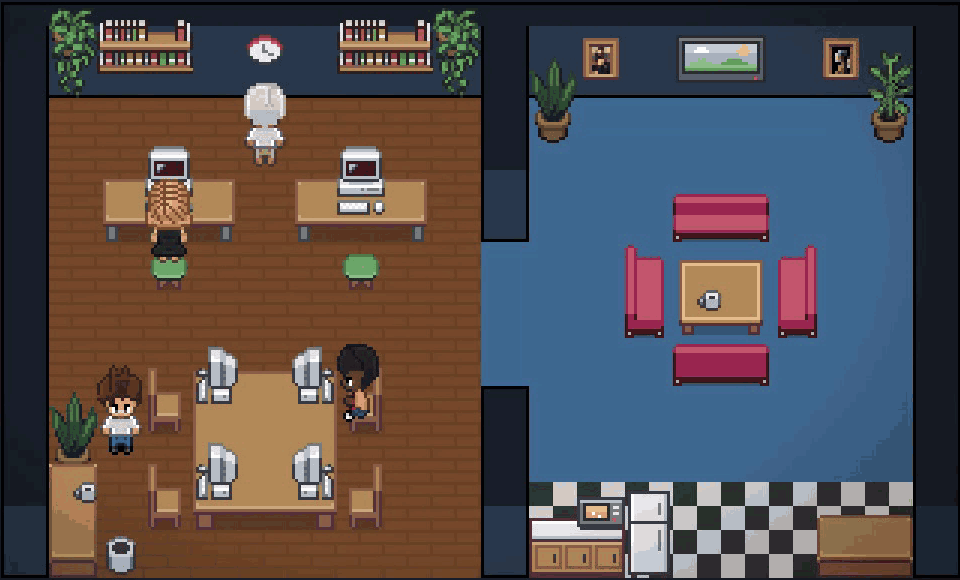
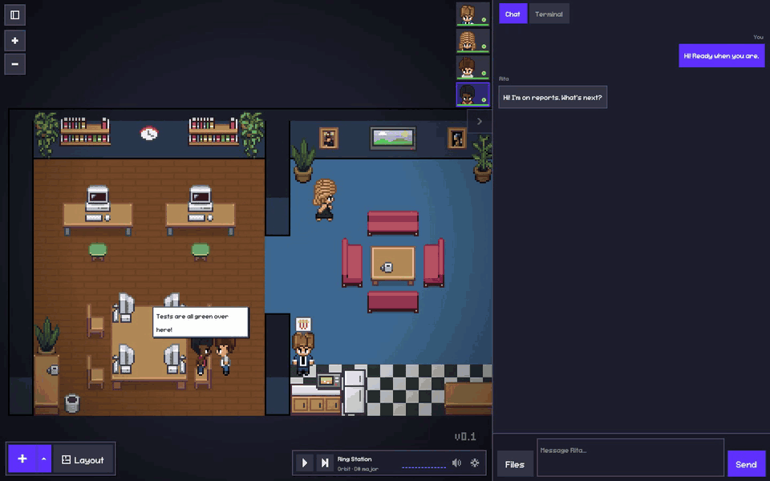

<div align="center">

# Escritorinho

**A pixel-art office where you _talk_ to your Claude Code agents.**

English · [Português (BR)](README.pt-BR.md)

[](LICENSE)


[](CONTRIBUTING.md)



</div>

Stop juggling terminals. Each of your Claude Code agents becomes a little character with a name and a job. When it works, it sits at its desk and types. When it's done, it gets up, chats with the others, watches TV, makes popcorn. When it needs you, it says so.

Click one and talk to it.

<div align="center">

</div>

## Features

- 🧑‍💼 **Named agents with a job.** Give each project folder an agent name ("Ana") and a briefing: its role, how it should work, where its notes are. The briefing reaches Claude Code every time an agent starts or resumes there. Nothing is written into your project.
- 💬 **Chat in speech bubbles.** What you write is typed into the agent's real terminal, so the chat and the terminal are two views of one session. The terminal is one tab away.
- 📎 **The desk.** Drop files on an agent (its chat, its card or the character itself). They land in an `escritorinho-desk/` folder in its project, and your next message tells it where.
- ✅ **Answer from the chat.** When the agent asks something ("allow this command?", "trust this folder?"), the chat shows one button per option. The screen is checked first, so no key is ever sent to a question that isn't there.
- 🛎️ **The reception.** Ask for an agent in plain words ("call the agent for the Acme site") and it gets created and sits down, with its briefing and notes.
- 🍿 **Office life.** Off duty, agents never rest at their desks (that looks like work!). They chat in real sentences, lounge on the sofa, watch TV and make popcorn, and drop it all the moment work arrives.
- 🌎 **English and Brazilian Portuguese**, switchable any time (Settings → Language).
- 🔒 **Local and private.** Listens on 127.0.0.1 only, no telemetry, and there is no "skip permissions" mode: every agent asks before acting.

## Quick start

You need **Node.js 20+** and **[Claude Code](https://claude.com/claude-code)** installed and logged in (`claude` on your PATH). macOS, Linux or Windows.

```bash
git clone https://github.com/felipelourencopvh/escritorinho.git
cd escritorinho
npm ci
npm run compile
node dist/cli.js --port 3100 --pty-host
```

Open the URL it prints (`http://127.0.0.1:3100/?token=…`). **Treat that URL as a password**: whoever has it can launch agents as you.

`--pty-host` keeps your agents running in a separate process, so restarting or updating Escritorinho doesn't end them.

## Using it

1. **+** → **+ Directory**: add a project folder. Give it an **agent name** and a **briefing** if you like.
2. Pick the folder in the **+** menu to start an agent there. It sits at a desk and its chat opens.
3. Write to it. Drop files on it. Answer its questions with the buttons.
4. Past conversations are in the left sidebar: click one to resume it.

### The reception

The reception is an ordinary agent whose briefing tells it to find the project in your notes, write the new agent's briefing and create it. Set it up once with [`docs/reception-briefing.md`](docs/reception-briefing.md). Scripts can do the same:

```bash
node dist/cli.js agent list                       # the office's agents
node dist/cli.js agent add --name Acme --path ~/code/acme --agent-name Ana \
  --briefing-file briefing.txt --launch            # create (or update) and open one
```

The command talks to the running office. The token comes from `~/.escritorinho/` and is never typed.

## Security and privacy

- The server listens on **127.0.0.1 only**. Every action that changes something (launching an agent, typing into it, saving a file on its desk) needs the token and the expected host, and uploads also check the page's origin.
- Files dropped on a desk keep only their base name, never overwrite an existing file and are never written through a symbolic link.
- Escritorinho reads Claude Code's transcripts (`~/.claude/projects/`) to show what agents do. Nothing is sent anywhere: no telemetry, no analytics.
- **Instant detection (hooks)** and **usage bars** are optional. Both ask before writing to `~/.claude/settings.json`, keep a backup, undo cleanly from Settings, and only ever touch their own entries.
- Its own data lives in `~/.escritorinho/`.

Found a vulnerability? Please report it privately: see [SECURITY.md](SECURITY.md).

## Contributing

**Escritorinho is young and every hand helps**: code, pixel art, translations, ideas, bug reports. Read [CONTRIBUTING.md](CONTRIBUTING.md) to get set up, then pick something:

- 🌍 **A new language.** Copy `webview-ui/src/i18n/en.ts`, translate, add one line to `LOCALES`. The build tells you if a key is missing.
- 🎨 **Pixel art.** New furniture (a coffee machine, a ping-pong table, a whiteboard), new characters, new office layouts.
- 🍿 **Office life.** More things to do off duty, more chat lines, agents that celebrate a finished task.
- 🤖 **Other agent CLIs.** The tracking is provider-based: see "Adding another agent CLI" in [CONTRIBUTING.md](CONTRIBUTING.md).
- 📦 **Packaging.** An `npx escritorinho` release, a desktop wrapper.

Not sure where to start? [Open an issue](https://github.com/felipelourencopvh/escritorinho/issues/new/choose) and say hi.

## Credits

Escritorinho is a fork of **[Pixel Agents](https://github.com/pixel-agents-hq/pixel-agents)** (MIT) by Pablo De Lucca and its contributors. The office, the characters, the layout editor and the agent tracking are their work; Escritorinho adds the conversation layer and the office life. If you only want to _watch_ your agents, try the original.

- Character art based on the **Metro City** pack by [JIK-A-4](https://jik-a-4.itch.io/metrocity-free-topdown-character-pack) (CC0).
- Escritorinho by Felipe Lourenço and [contributors](https://github.com/felipelourencopvh/escritorinho/graphs/contributors).

MIT: see [LICENSE](LICENSE).
