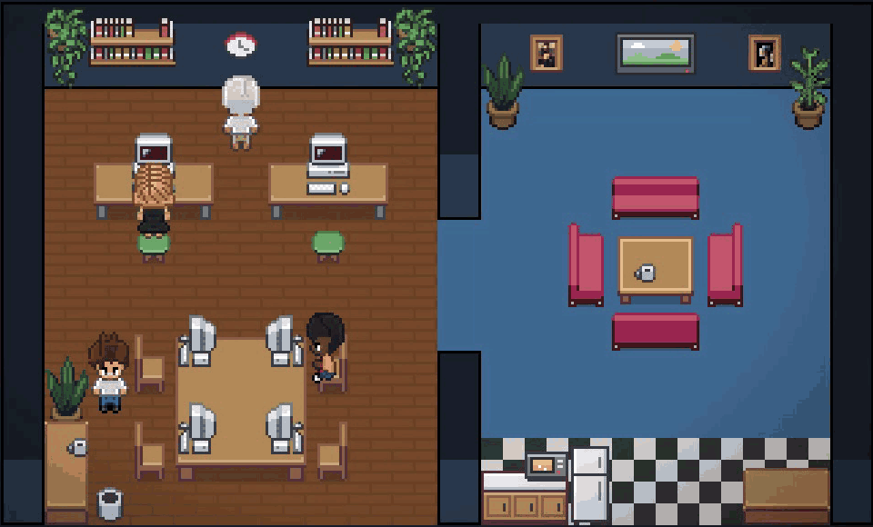
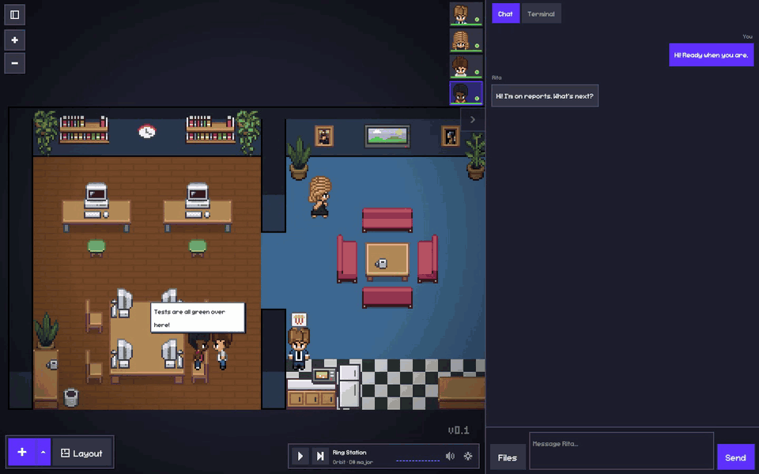

<div align="center">

# Escritorinho

**Um escritório em pixel art onde você _conversa_ com os seus agentes do Claude Code.**

[English](README.md) · Português (BR)

[](LICENSE)


[](CONTRIBUTING.md)



</div>

Chega de malabarismo com terminais. Cada agente do Claude Code vira um bonequinho com nome e função. Quando está trabalhando, senta na mesa e digita. Quando termina, levanta, conversa com os colegas, assiste TV e faz pipoca. Quando precisa de você, avisa.

Clique num deles e converse.

<div align="center">

</div>

## O que ele faz

- 🧑‍💼 **Agentes com nome e função.** Cada pasta de projeto pode ter um nome de agente ("Ana") e um briefing: o papel dele, como deve trabalhar e onde ficam as anotações. O briefing vai para o Claude Code sempre que um agente começa ou é retomado ali, sem gravar nada no seu projeto.
- 💬 **Chat em balões.** O que você escreve é digitado no terminal de verdade do agente: chat e terminal são a mesma sessão, e o terminal fica a uma aba de distância.
- 📎 **A mesa.** Solte arquivos no agente (no chat, no cartão ou no próprio boneco). Eles vão para a pasta `escritorinho-desk/` do projeto, e a sua próxima mensagem avisa onde estão.
- ✅ **Responder pelo chat.** Quando o agente pergunta algo ("posso rodar este comando?", "confiar nesta pasta?"), o chat mostra um botão para cada opção. A tela é conferida antes: nenhuma tecla é enviada se a pergunta não estiver lá.
- 🛎️ **A recepção.** Peça um agente com as suas palavras ("chama o agente do site da Acme") e ele é criado e senta na mesa, com briefing e anotações.
- 🍿 **Vida de escritório.** De folga, os agentes nunca descansam na mesa (parece trabalho!). Conversam com frases de verdade, deitam no sofá, assistem TV, fazem pipoca, e largam tudo assim que chega trabalho.
- 🌎 **Português do Brasil e inglês**, troca quando quiser (Configurações → Idioma).
- 🔒 **Local e privado.** Só escuta em 127.0.0.1, sem telemetria, e não existe modo de "pular autorizações": todo agente pergunta antes de agir.

## Como rodar

Precisa de **Node.js 20+** e do **[Claude Code](https://claude.com/claude-code)** instalado e logado (`claude` no PATH). macOS, Linux ou Windows.

```bash
git clone https://github.com/felipelourencopvh/escritorinho.git
cd escritorinho
npm ci
npm run compile
node dist/cli.js --port 3100 --pty-host
```

Abra o endereço que aparecer (`http://127.0.0.1:3100/?token=…`). **Esse endereço é como uma senha**: quem tiver ele consegue abrir agentes no seu nome.

Com `--pty-host`, os agentes continuam rodando num processo separado, então reiniciar ou atualizar o Escritorinho não fecha nenhum deles.

## Como usar

1. **+** → **+ Pasta**: adicione a pasta de um projeto. Se quiser, dê um **nome de agente** e um **briefing**.
2. Escolha a pasta no menu **+** para abrir um agente ali. Ele senta numa mesa e o chat abre.
3. Escreva para ele. Solte arquivos nele. Responda às perguntas dele pelos botões.
4. As conversas anteriores ficam na barra da esquerda: clique numa para retomar.

### A recepção

A recepção é um agente comum cujo briefing manda procurar o projeto nas suas anotações, escrever o briefing do novo agente e criá-lo. Configure uma vez com o modelo em [`docs/reception-briefing.md`](docs/reception-briefing.md). Scripts podem fazer o mesmo:

```bash
node dist/cli.js agent list                       # os agentes do escritório
node dist/cli.js agent add --name Acme --path ~/code/acme --agent-name Ana \
  --briefing-file briefing.txt --launch            # cria (ou atualiza) e abre um
```

O comando conversa com o escritório que está rodando. O token vem de `~/.escritorinho/` e nunca precisa ser digitado.

## Segurança e privacidade

- O servidor só escuta em **127.0.0.1**. Toda ação que muda alguma coisa (abrir agente, digitar nele, salvar arquivo na mesa) exige o token e o endereço esperado, e o envio de arquivos também confere a origem da página.
- Arquivos soltos na mesa ficam só com o nome (sem caminho), nunca sobrescrevem outro arquivo e nunca são gravados através de link simbólico.
- O Escritorinho lê as transcrições do Claude Code (`~/.claude/projects/`) para mostrar o que os agentes fazem. Nada é enviado para fora: sem telemetria, sem estatísticas.
- **Detecção instantânea (ganchos)** e **barras de uso** são opcionais. As duas pedem autorização antes de mexer no `~/.claude/settings.json`, guardam uma cópia de segurança, desfazem pelas Configurações e só mexem nas próprias entradas.
- Os dados dele ficam em `~/.escritorinho/`.

Achou uma falha de segurança? Avise em particular: veja o [SECURITY.md](SECURITY.md).

## Como contribuir

**O Escritorinho está começando e toda ajuda conta**: código, pixel art, tradução, ideias, relato de bug. Leia o [CONTRIBUTING.md](CONTRIBUTING.md) para montar o ambiente e escolha algo:

- 🌍 **Um idioma novo.** Copie `webview-ui/src/i18n/en.ts`, traduza e acrescente uma linha em `LOCALES`. O build avisa se faltar alguma chave.
- 🎨 **Pixel art.** Móveis novos (cafeteira, mesa de pingue-pongue, quadro branco), personagens novos, escritórios novos.
- 🍿 **Vida de escritório.** Mais coisas para fazer na folga, mais frases de conversa, agente comemorando tarefa concluída.
- 🤖 **Outros agentes de terminal.** O acompanhamento é por provedor: veja "Adding another agent CLI" no [CONTRIBUTING.md](CONTRIBUTING.md).
- 📦 **Empacotamento.** Um `npx escritorinho`, uma versão de desktop.

Não sabe por onde começar? [Abra uma issue](https://github.com/felipelourencopvh/escritorinho/issues/new/choose) e dê um oi, pode ser em português.

## Créditos

O Escritorinho é baseado no **[Pixel Agents](https://github.com/pixel-agents-hq/pixel-agents)** (MIT), de Pablo De Lucca e colaboradores. O escritório, os personagens, o editor de layout e o acompanhamento dos agentes são trabalho deles; o Escritorinho acrescenta a conversa e a vida de escritório. Se você só quer _assistir_ aos agentes, experimente o original.

- Personagens baseados no pacote **Metro City** de [JIK-A-4](https://jik-a-4.itch.io/metrocity-free-topdown-character-pack) (CC0).
- Escritorinho por Felipe Lourenço e [colaboradores](https://github.com/felipelourencopvh/escritorinho/graphs/contributors).

MIT: veja a [LICENSE](LICENSE).
